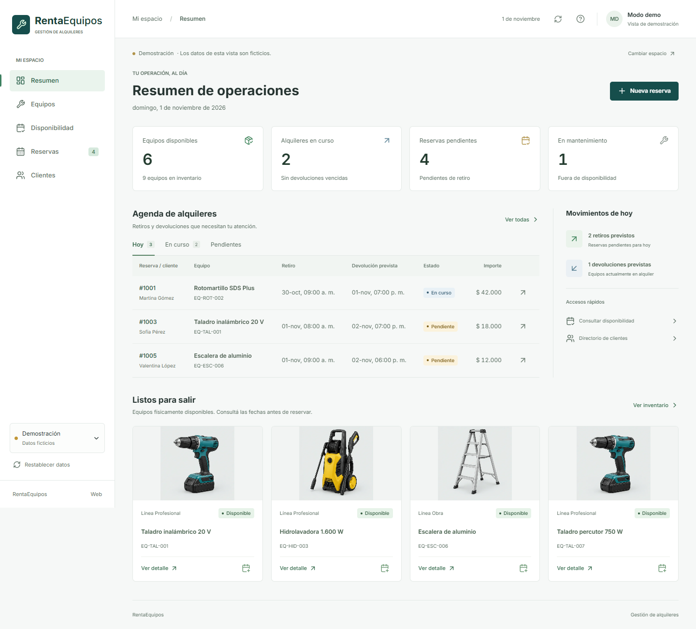

# RentaEquipos Web

Aplicación React y TypeScript para operar el alquiler de herramientas y equipos sobre la API de AlquilerEquipos. Reemplaza las pantallas de ventas heredadas de ComercioPedidos; la aplicación React Native no se modifica.



## Pantallas

- Resumen con inventario, agenda de retiros y devoluciones y alquileres vencidos.
- Equipos con búsqueda, filtros, vistas de tarjetas/lista y CRUD.
- Disponibilidad por período, excluyendo mantenimiento y conflictos informados por la API.
- Reservas: creación, detalle, cancelación, retiro y devolución con mantenimiento opcional.
- Clientes: búsqueda, ficha, historial y CRUD.
- Formularios con validación, confirmaciones, errores de servicio y navegación adaptable a celular.

## Requisitos

Node.js 24 LTS, npm y el backend .NET 10 configurado para trabajar con datos reales. Las pruebas unitarias usan el soporte nativo de TypeScript de Node 24. La implementación fue compilada con Node 24.22.1.

## Inicio rápido: demostración

Para usar SQL real y autenticación Windows en esta PC, ver [Uso local](../../USO-LOCAL.md). Esa instalación sirve el frontend compilado desde la API; no usa el proxy de Vite ni guarda contraseñas Windows. `VITE_WINDOWS_LOCAL=true` se configura solo durante su compilación local.

Desde esta carpeta, en PowerShell:

```powershell
npm ci
$env:VITE_DEMO_MODE = "true"
npm run dev
```

Abrir la URL que imprime Vite, normalmente `http://127.0.0.1:5173/`. Si ese puerto está ocupado, Vite selecciona otro. La demostración es explícita, utiliza personas y equipos ficticios y guarda sus cambios en `sessionStorage` de la pestaña. Cerrar la pestaña descarta esos cambios. El botón para restablecer datos pide confirmación.

**No ingresar datos personales reales en la demostración.** No hay migraciones, escrituras SQL ni solicitudes a la API en este modo. Un fallo de la API nunca activa automáticamente datos ficticios.

## Conexión con la API

```powershell
Copy-Item .env.example .env.local
Remove-Item Env:VITE_DEMO_MODE -ErrorAction SilentlyContinue
npm run dev
```

Completar `.env.local` antes de reiniciar Vite. El archivo de ejemplo deja la demostración y el acceso anónimo desactivados. `VITE_API_URL=/api` utiliza el proxy de desarrollo hacia `http://127.0.0.1:5272`; iniciar el backend por separado según su README.

Si se eligió antes la demostración en la misma pestaña, usar **Cambiar espacio > Conectar con la API**. La elección de modo de esa pestaña tiene prioridad sobre el valor inicial del entorno.

Para desarrollo aislado sin proveedor de identidad, se puede activar `VITE_ALLOW_ANONYMOUS_API=true` junto con `Authentication__AllowAnonymousDevelopment=true` en el backend. La opción del cliente solo funciona en compilaciones de desarrollo. No usarla con datos reales ni exponerla públicamente.

### Autenticación

El frontend no crea usuarios ni emite JWT. Utiliza un proveedor OIDC externo mediante Authorization Code + PKCE:

| Variable | Uso |
| --- | --- |
| `VITE_OIDC_AUTHORITY` | Authority HTTPS del proveedor |
| `VITE_OIDC_CLIENT_ID` | Cliente público SPA, sin secreto |
| `VITE_OIDC_REDIRECT_URI` | Callback registrado; por defecto el origen con `/` |
| `VITE_OIDC_SCOPE` | Scopes, incluyendo el permiso de la API si el proveedor lo requiere |
| `VITE_OIDC_AUDIENCE` | Audience opcional para proveedores que la admiten |
| `VITE_OIDC_ROLE_CLAIM` | Claim de roles; por defecto `role` |
| `VITE_CURRENCY` | Código monetario de tres letras; por defecto `ARS` |

Configurar también Authority/Audience en el backend. Los roles esperados son `Administrador`, `Operador` y `Consulta`. El cliente oculta acciones según el rol; la autorización efectiva siempre corresponde a la API. Los access tokens permanecen en memoria, no en localStorage ni sessionStorage. Solo el estado temporal del intercambio PKCE se conserva en sessionStorage. Recargar puede requerir iniciar sesión de nuevo.

Todas las variables `VITE_*` son públicas en el navegador. Nunca incluir contraseñas SQL, secretos de cliente ni claves de firma.

## Contratos y límites

- Listados `GET /api/equipos`, `/api/clientes` y `/api/reservas`, con `pagina` y `tamanioPagina`. Se cargan hasta cinco páginas de 100 registros por recurso; si se alcanza ese umbral se muestra una advertencia de vista parcial. No es una solución de análisis de inventarios masivos.
- Disponibilidad: `GET /api/equipos/disponibles?fechaInicio=...&fechaFin=...`, paginado hasta 500 equipos; se rechaza mostrar un resultado potencialmente truncado.
- Fechas ingresadas en horario local, enviadas como ISO UTC. Períodos semiabiertos: el fin de una reserva puede ser el inicio de otra.
- El POST de reserva vuelve a validar disponibilidad en el servidor. La consulta previa no garantiza que otro operador no reserve antes.
- El importe es pactado, no una tarifa automática. La interfaz limita la entrada a 9.999.999.999,99 para mantener precisión práctica en JavaScript; muestra centavos cuando corresponden.
- El retiro exige período vigente y equipo físicamente disponible. La devolución usa la hora del servidor y permite marcar mantenimiento.
- No hay reintentos automáticos de escrituras. Ante una interrupción de red, verificar el estado actual antes de reenviar una operación: el servidor puede haberla procesado.
- No se cargan fotografías reales porque el contrato de equipos no contiene imágenes. Solo la demostración utiliza ilustraciones referenciales.

## Verificación

```powershell
npm run build
npm run lint
npm run test:unit
npx playwright install chromium
npm run test:e2e
```

Para utilizar Edge ya instalado en Windows:

```powershell
$env:PLAYWRIGHT_CHANNEL = "msedge"
npm run test:e2e
```

Las pruebas de navegador cubren datos ficticios, contratos HTTP interceptados y un proveedor OIDC simulado para verificar PKCE, retorno a la pantalla original y permisos visuales. No equivalen a pruebas de persistencia SQL ni de un proveedor OIDC real. Los resultados concretos se documentan en `VERIFICACION.md`.

## Producción

```powershell
npm run build
```

Publicar `dist/` con HTTPS y fallback de rutas a `index.html`. El proxy de Vite no existe en producción: el servidor debe dirigir `/api` al backend, o configurar `VITE_API_URL` antes de compilar y permitir únicamente el origen correcto en CORS. Registrar el callback y el cierre de sesión del dominio real en el proveedor OIDC. Aplicar una política CSP compatible con la autoridad configurada y con los estilos de imágenes de demostración. Esta tarea no realiza despliegues.

## Organización

```text
src/
  components/    Formularios, detalles, tablas y controles reutilizables
  context/       Sesión OIDC, datos, modales y notificaciones
  domain/        Tipos del dominio de alquileres
  lib/           Cliente HTTP, demostración y formatos
  App.tsx        Navegación y estados globales
  Pages.tsx      Vistas operativas
  tokens.css     Colores, tipografía, espaciado y estados compartidos
  styles.css     Diseño adaptable
tests/           Pruebas Playwright y accesibilidad con axe
public/images/   Recursos visuales de demostración
```

## Recursos visuales

Los criterios de carga, adaptación, accesibilidad e interacción se documentan en
[Criterios de interfaz](docs/DISENO.md).

`public/images/equipos-demo.webp` se generó con la herramienta integrada de generación de imágenes el 1 de noviembre de 2026 y se optimizó a WebP (121 KB, frente a 1,75 MB del PNG original). Prompt resumido: atlas fotográfico 3×2 de herramientas genéricas sin marcas (taladro, rotomartillo, hidrolavadora, generador, sierra y escalera), fondo gris de estudio, sin etiquetas ni logotipos. Son ilustraciones de catálogo ficticio, no fotos del inventario del negocio. La fuente Inter se distribuye localmente mediante `@fontsource/inter`; los iconos son Lucide.
